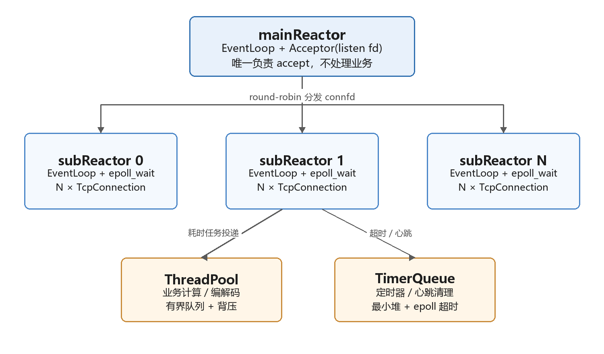

# 高性能 Reactor 网络库技术设计说明

| 项目 | 内容 |
| --- | --- |
| 文档版本 | v1.0 |
| 对应系统 | 基于 Reactor 模式的 C++11 高性能网络库 / 服务器 |
| 技术栈 | Linux、epoll、非阻塞 IO、多线程、线程池、智能指针、Socket 编程 |
| 适用读者 | 项目评审、技术面试、后续维护者 |
| 文档性质 | 设计说明 + 技术选型论证 + 实现细节 |

---

## 0. 阅读导引

这份文档不是 API 手册，而是回答三个问题：**为什么这么做、为什么不那么做、具体怎么做的**。

- 只想快速了解项目：读第 1 章和第 12、13 章。
- 关注架构决策：读第 2、3、4 章的选型矩阵与对比论证。
- 关注实现细节：读第 5 至第 9 章，每章都给出关键代码与不变量。
- 准备面试答辩：读第 14 章"局限与演进"和第 16 章附录 D 的问答清单。

全文贯穿一条主线：**每个技术选择都是在一个具体约束下，用可接受的代价换取另一个维度的收益**。因此每一节都同时写明"选它的理由"和"它在什么场景下是错的"。

---

## 1. 项目概述

### 1.1 定位

一个从零实现、不依赖任何网络框架的 C++11 网络库：以 epoll 为事件源，以"主从 Reactor + one loop per thread"为并发骨架，向上提供"注册回调即可收发消息"的服务器编程接口，向下封装 socket、缓冲区、定时器、线程池与连接生命周期管理。

设计目标不是复刻某个工业级框架，而是把 Linux 网络编程中真正决定性能与正确性的机制完整走一遍，并让每一处取舍都能被验证、被解释。

### 1.2 目标与非目标

| 类别 | 内容 |
| --- | --- |
| 目标 | 单机万级并发长连接；每连接固定线程、无跨线程锁竞争；二进制协议解决粘包；连接与缓冲区生命周期无泄漏；核心代码可读、可裁剪 |
| 目标 | 依赖仅 glibc + pthread + C++11 标准库，`cmake && make` 即可构建 |
| 非目标 | 不做 TLS、HTTP/2、服务发现、序列化框架 |
| 非目标 | 不追求跨平台（Windows 的 IOCP 是另一套模型） |
| 非目标 | 不做集群与多进程负载均衡 |

明确"不做什么"同样重要：把 TLS、HTTP 解析、RPC 编解码塞进网络库，会让核心事件循环被 IO 之外的逻辑淹没，也让性能瓶颈难以定位。

### 1.3 设计指标

| 指标 | 目标值 | 验证方式 |
| --- | --- | --- |
| 并发连接 | 单机 10000+ 稳定在线 | 客户端批量建连，观察 RSS 与 fd 数 |
| 吞吐 | 4 核回环 20 万 QPS 量级（小报文 ping-pong） | 自研压测客户端 + `perf stat` |
| 延迟 | 回环 P99 亚毫秒 | 客户端记录 RTT 直方图 |
| CPU | 空载时事件循环 CPU 占用接近 0 | 空闲连接挂机观察 |
| 内存 | 每连接用户态开销 1~2 KB | `sizeof` + 堆采样 |
| 稳定性 | 72 小时压测无 fd 泄漏、无内存增长 | `valgrind` / `heaptrack` / RSS 曲线 |

> 表中数值是设计目标与实测量级，具体数字随硬件、报文大小、业务回调耗时变化，正式验收应以目标机器上的实测报告为准（方法见第 11.1 节）。

### 1.4 总体架构



数据流：客户端连接 → mainReactor 的 Acceptor 接受 → 按轮询策略投递到某个 subReactor 线程 → 该连接此后所有读写、解码、超时都在同一线程内完成 → 耗时业务通过线程池异步处理，结果再投递回原线程发送。

### 1.5 模块划分

| 模块 | 关键类 | 职责 |
| --- | --- | --- |
| 事件循环 | `EventLoop`、`TimerQueue`、`Timer` | 驱动 poller、执行待办任务、管理定时器 |
| IO 复用 | `Poller`、`EPollPoller` | 封装 epoll_create/ctl/wait，屏蔽 LT/ET 细节 |
| 事件分发 | `Channel` | 把 fd 上的事件映射为可读/可写/错误回调 |
| 接受连接 | `Acceptor` | 持有 listen fd，循环 accept，回调交给 TcpServer |
| 连接管理 | `TcpConnection`、`TcpServer` | 连接状态机、读写缓冲、回调分发、生命周期 |
| 协议编解码 | `Codec`、`Buffer` | 长度前缀成帧、半包缓存、字节序转换 |
| 并发 | `ThreadPool`、`EventLoopThread`、`EventLoopThreadPool` | 线程创建、任务队列、线程与 loop 绑定 |
| 基础设施 | `Socket`、`InetAddress`、`Logging`、`Timestamp` | RAII fd、地址封装、日志、时间 |

---

## 2. 设计约束与技术选型总览

### 2.1 约束条件

任何选型都必须在约束下讨论，脱离约束的"最优"没有意义。本项目的约束是：

1. **语言约束**：C++11，不能使用 C++20 协程、`std::jthread`、`std::atomic<std::shared_ptr>`。
2. **平台约束**：Linux（目标内核 4.x 以上），必须使用 epoll。
3. **依赖约束**：不引入 Boost、libevent 等第三方库，避免"框架替我做了"的黑盒。
4. **规模约束**：单机万级连接、千兆/万兆网卡、4~16 核。
5. **目标约束**：以学习机制与可讲清原理为第一优先级，性能达标即可，不追求极限。

### 2.2 选型决策矩阵

| 决策点 | 候选方案 | 本项目选择 | 决定性理由 | 被淘汰方案在什么场景更优 |
| --- | --- | --- | --- | --- |
| IO 模型 | 阻塞 IO / 非阻塞+IO 复用 / 异步 IO | 非阻塞 + epoll | 单线程可管理万级 fd，事件驱动无空转 | 阻塞 IO 在"连接数少、逻辑串行"的脚本型服务中更简单 |
| 事件分发 | Reactor / Proactor | Reactor | Linux 上没有便宜好用的真异步；Reactor 语义直观、可控 | Proactor 在 Windows IOCP 上更自然；io_uring 成熟后更优 |
| 复用器 | select / poll / epoll / io_uring | epoll（ET） | O(1) 就绪通知、无 fd 上限、无全量拷贝 | select 在 fd<100 的嵌入式场景够用且可移植；io_uring 在高 IOPS 存储型负载更强 |
| 线程组织 | 每连接一线程 / 单 Reactor / 主从 Reactor / 多进程 | 主从 Reactor + one loop per thread | 连接数不受线程数限制，线程间无共享、无锁 | 多进程在需要故障隔离（nginx worker）时更稳；单 Reactor 在极低并发下代码最少 |
| 线程通信 | 互斥锁+条件变量 / 无锁队列 / 协程 | mutex + condition_variable | 语义清晰、C++11 原生、任务粒度下开销可忽略 | 无锁队列在 ns 级高频小任务下更优；协程在超长调用链业务中更优雅 |
| 成帧方式 | 定长 / 分隔符 / 长度前缀 / TLV | 长度前缀 + 固定头 | O(1) 定位、二进制安全、无转义开销 | 分隔符在纯文本协议（如 Redis RESP、SMTP）中可读性更好 |
| 内存管理 | 裸指针 / 引用计数 / GC / 对象池 | `shared_ptr`/`weak_ptr` + RAII | 确定性析构（fd 必须及时关闭）、无 GC 停顿 | 对象池在高频短生命周期对象场景可再降 10%~20% 分配开销 |
| 构建 | Makefile / CMake | CMake | 跨发行版、易集成 CTest | Makefile 在单文件小工具中更直接 |

矩阵里的"被淘汰方案在什么场景更优"一列是刻意保留的：面试中最容易被追问的不是"你为什么选 A"，而是"如果换成 B 会怎样"。能说清 B 的适用边界，才说明真的理解 A。

---

## 3. 网络模型：为什么是 Reactor

### 3.1 Linux 的五种 IO 模型

UNIX 网络编程把 IO 拆成两个阶段：**等待数据就绪**与**把数据从内核拷贝到用户态**。五种模型的差别就在于这两个阶段由谁阻塞。

| 模型 | 等待数据 | 数据拷贝 | 单线程能否管理多连接 | 典型代表 |
| --- | --- | --- | --- | --- |
| 阻塞 IO | 阻塞 | 阻塞 | 否（一连接一线程） | 最朴素的 socket 编程 |
| 非阻塞 IO | 轮询，立即返回 EAGAIN | 阻塞 | 能，但空转烧 CPU | 忙轮询客户端 |
| IO 多路复用 | 阻塞在 select/epoll_wait | 阻塞 | 能 | epoll、select、poll |
| 信号驱动 IO | 不阻塞，SIGIO 通知 | 阻塞 | 能，但信号不可靠 | `F_SETSIG` + `sigaction` |
| 异步 IO | 不阻塞 | 不阻塞（内核完成） | 能 | io_uring、Windows IOCP、POSIX AIO |

关键结论：**IO 多路复用并没有让 IO 变快，它只是把"每个连接一个阻塞点"变成"所有连接共用一个阻塞点"**。真正的收益是线程数从 O(连接数) 降为 O(核数)。

### 3.2 为什么"阻塞 IO + 线程池"走不通

一个常见的直觉是：既然线程池能复用线程，那把阻塞的 `read` 丢进线程池不就行了？

问题在于阻塞 `read` 会**占住**线程直到数据到达。线程池大小若为 N，则同时最多只有 N 个连接处于"可服务"状态。要支持 1 万连接，就必须有 1 万条线程，这就退化成 thread-per-connection。其代价可以量化：

| 成本项 | 量级 | 说明 |
| --- | --- | --- |
| 线程栈 | 默认 8 MB 虚拟地址/线程 | 1 万线程 = 80 GB 虚拟地址，虽不全部驻留，但 VMA 数量会撞上 `vm.max_map_count`（默认 65530） |
| 内核栈 + task_struct | 约 16~32 KB/线程 | 1 万线程约 160~320 MB 常驻内存，与业务无关 |
| 上下文切换 | 2~5 µs/次 | 调度器在 1 万个可运行实体间做 O(n) 选择，缓存与 TLB 全部失效 |
| 同步 | 每连接一把锁或一个队列 | 连接状态无法线程封闭，处处需要加锁 |

更本质的问题是**阻塞模型下线程数量与连接数量线性相关**，而 epoll 模型下二者解耦。这就是 C10K 问题的核心。

> 反过来说，如果连接数只有几十、每个连接的计算很重（如数据库连接池中的长事务），阻塞 IO + 线程池反而更简单，因为线程数天然被业务并发度限制住了。

### 3.3 Reactor 与 Proactor 的本质区别

```
Reactor（就绪通知）                       Proactor（完成通知）
─────────────────────                     ─────────────────────
应用注册"可读时通知我"                    应用提交"读 4KB 到 buf"
        │                                         │
   epoll_wait 返回可读                       内核自己完成拷贝
        │                                         │
应用自己调用 read() 拷贝数据                 内核通知"已完成，共 n 字节"
        │                                         │
   处理数据                                    直接处理数据
```

| 维度 | Reactor | Proactor |
| --- | --- | --- |
| 通知语义 | 资源就绪 | 操作完成 |
| 谁做数据拷贝 | 应用线程 | 内核（或模拟层） |
| 编程复杂度 | 需处理 EAGAIN、半包、部分写 | 回调即完整结果，逻辑更线性 |
| 性能 | 多一次用户态/内核态协作，但零额外线程 | 理论上更少拷贝，但依赖内核支持 |
| Linux 支持 | epoll 原生 | 只有 io_uring 是真异步 |

**为什么 Linux 上选 Reactor**：

1. `epoll` 是就绪型，天然对应 Reactor；把 Proactor 接口架在 epoll 上（如 Boost.Asio 在 Linux 的默认实现）本质是"Reactor + 用户态完成队列"，多一层封装但没有减少系统调用。
2. POSIX AIO（`aio_read`）在 glibc 中用用户态线程池模拟，**既没有减少线程，又增加了调度开销**，且内核对 socket 的 AIO 支持长期缺失。
3. `io_uring`（5.1+）是真正的异步，但需要 `liburing`、SQE/CQE 编程模型、注册缓冲区与内核版本兼容处理。对一个以"讲清机制"为目标的项目，引入它会掩盖 Reactor 的教学价值；它已列入第 14 章的演进路线。

### 3.4 Reactor 的四种组织形态

| 形态 | 结构 | 优点 | 缺点 | 典型使用者 |
| --- | --- | --- | --- | --- |
| 单 Reactor 单线程 | 1 loop 做 accept + read + 业务 | 无并发问题，代码最短 | 业务阻塞会拖垮全部连接；无法用多核 | Redis（配合内存操作极快）、早期 Node.js |
| 单 Reactor 多线程 | 1 个 IO 线程 + 业务线程池 | 业务不阻塞 IO | IO 线程仍是瓶颈；连接状态需加锁 | 部分 Java NIO 早期实现 |
| 主从 Reactor | main 只 accept，多个 sub 各自跑 loop | IO 随核扩展；每连接线程封闭，无锁 | 连接在 sub 间可能不均 | **本项目**、muduo、Netty |
| 多 Reactor 多进程 | 每进程一个 loop，SO_REUSEPORT | 故障隔离、可跨机 | 共享状态（连接表、广播、限流）需 IPC | nginx worker、HAProxy |

**为什么选主从而不是单 Reactor 多线程**：单 Reactor 多线程里，`epoll_wait`、`read`、`write` 全在一个线程，4 核机器只能用 1 核做 IO，另外 3 核在等业务队列；而主从模型下每个 subReactor 独占一核，连接在其所属线程内完成全部 IO 与解码，**没有任何共享可变状态，因此不需要锁**。这是"线程封闭（thread confinement）"带来的最大红利。

**为什么不是多进程**：多进程能提供故障隔离（一个 worker 崩溃不影响其他），但本项目需要维护全局连接表、跨连接广播、统一限流，这些在多进程下都要引入共享内存或消息总线，复杂度陡增。当业务是无共享状态的 HTTP 静态服务时，多进程才是更优解——这正是 nginx 的选择逻辑。

### 3.5 主从模型的一次连接生命周期

```
client            mainReactor                subReactor(k)            业务线程
  │                    │                          │                     │
  │──TCP SYN──────────>│                          │                     │
  │<──SYN/ACK──────────│                          │                     │
  │──ACK + 请求数据───>│ epoll: listen fd 可读     │                     │
  │                    │ accept4() 得到 connfd     │                     │
  │                    │ round-robin 选 k          │                     │
  │                    │──runInLoop(newConnection)─>│                     │
  │                    │                          │ 构造 TcpConnection   │
  │                    │                          │ 注册 EPOLLIN|ET      │
  │                    │                          │<──可读，读到 200 字节│
  │                    │                          │ 解码出 1 个完整请求  │
  │                    │                          │──post(业务任务)─────>│
  │                    │                          │                     │ 处理
  │                    │                          │<──post(响应)────────│
  │                    │                          │ send() 一次写完     │
  │<──响应─────────────│                          │                     │
```

三个细节决定了这个流程的正确性：

1. `accept` 必须循环到 `EAGAIN`，因为 listen fd 在 ET 模式下只通知一次，一次只 accept 一个连接会漏掉同批到达的连接。
2. `newConnection` 必须**投递**到 subReactor 线程执行，不能直接在 mainReactor 里构造 `TcpConnection`——否则对象创建在 A 线程、使用在 B 线程，`Channel` 注册的 fd 也会挂到错误的 epoll 实例上。
3. 连接的销毁同样要回到所属线程执行，见第 9.4 节。

---

## 4. IO 多路复用：为什么是 epoll

### 4.1 epoll 的内部结构

`epoll` 在内核中维护一个 `eventpoll` 对象，包含两部分：

- **红黑树（rbr）**：存放所有被监视的 fd，`epoll_ctl(ADD/MOD/DEL)` 是 O(log n)，只在注册/修改时发生。
- **就绪链表（rdllist）**：当某个 fd 上有事件到达，内核通过该 fd 的等待队列回调 `ep_poll_callback`，把这个 fd 对应的 `epitem` 挂到就绪链表上。

`epoll_wait` 的工作因此变成：**如果就绪链表为空就睡眠，否则把链表上的事件拷到用户数组**。复杂度是 O(就绪数 k)，与总连接数 n 无关。这正是它相对 select/poll 的本质优势。

### 4.2 select / poll / epoll 对比

| 维度 | select | poll | epoll |
| --- | --- | --- | --- |
| 数据结构 | 位图 `fd_set` | `pollfd` 数组 | 内核红黑树 + 就绪链表 |
| 单进程 fd 上限 | `FD_SETSIZE`（通常 1024，编译期固定） | 无硬上限，受 `RLIMIT_NOFILE` 限制 | 受 `max_user_watches` 与 `RLIMIT_NOFILE` 限制 |
| 每次调用开销 | O(n) 扫描 + 全量拷贝 fd_set 进出内核 | O(n) 扫描 + 全量拷贝 pollfd 数组 | O(k) 拷贝就绪事件 |
| 1 万连接时的单次开销 | 不可能（超 1024） | 每次约 80 KB 拷贝 + 1 万次遍历 | 无事件时几乎为零；100 个就绪仅拷 1.2 KB |
| 事件注册成本 | 每次调用重建 | 每次调用重建 | `epoll_ctl` 一次，长期有效 |
| 触发模式 | 仅水平触发 | 仅水平触发 | LT / ET / EPOLLONESHOT |
| 可移植性 | 全平台 | 全平台 | Linux 专有（kqueue 为 BSD 等价物） |

一个具体的数字对比：1 万连接、每秒 1000 个事件。poll 方案每秒要做 1000 次 × 1 万 = 10^7 次内核遍历与 80 MB 拷贝；epoll 方案每秒只处理 1000 个事件，拷贝 12 KB。差距在三个数量级以上。

> 但 select 并非一无是处：fd 少于 100、需要跨 Windows/macOS/Linux 移植、或代码体量极小的场景，select 的零依赖与可移植性仍然占优。epoll 的优势只在**大并发 + 长连接**时成立。

### 4.3 水平触发与边沿触发

| 维度 | LT（水平触发，默认） | ET（边沿触发） |
| --- | --- | --- |
| 通知条件 | 只要缓冲区还有数据，每次 `epoll_wait` 都报 | 只在状态变化时报一次 |
| 编程要求 | 读多少都行，没读完下次还会通知 | **必须一次读到 EAGAIN**，否则数据滞留且不再通知 |
| 代码复杂度 | 低 | 高，需要循环读写 |
| 系统调用次数 | 多（同一份数据可能被多次通知） | 少（状态变化才唤醒） |
| 惊群影响 | 多线程下更易重复唤醒 | 较小 |

**本项目选择 ET，理由有三**：

1. 配合非阻塞 fd，一次事件回调里把数据读干净，`epoll_wait` 的返回次数与真实事件数一一对应，没有"通知了但没数据可读"的空转。
2. ET 天然要求"读干净"，这迫使代码必须正确处理半包与缓冲区，正好与协议解码的需求吻合。
3. 在大量空闲连接（IM、推送场景的典型形态）下，LT 的重复通知会带来可观测的额外 CPU。

**ET 的代价**是三条必须遵守的纪律，任何一条违反都会表现为"偶发丢消息"这种极难排查的 bug：

```cpp
// 纪律 1：读必须循环到 EAGAIN
for (;;) {
    ssize_t n = ::read(fd_, buf, sizeof buf);
    if (n > 0)  { /* 处理数据，继续读 */ }
    else if (n == 0) { /* 对端关闭，读到 EOF */ break; }
    else {
        if (errno == EAGAIN || errno == EWOULDBLOCK) break; // 读干净了
        if (errno == EINTR) continue;                       // 被信号打断，重试
        /* 真错误 */ break;
    }
}

// 纪律 2：accept 也要循环到 EAGAIN
// 纪律 3：写只在"有剩余数据"时关注 EPOLLOUT，写完立即取消关注
```

### 4.4 epoll 使用中的六个坑

| 坑 | 现象 | 原因 | 处理 |
| --- | --- | --- | --- |
| ET 只读一次 | 高负载下偶发丢包 | 内核缓冲区剩余数据不再触发通知 | 循环读到 EAGAIN |
| 边写边关注 EPOLLOUT | CPU 100%，`epoll_wait` 立即返回 | 发送缓冲区可写是常态，LT 下持续触发 | 只在 output buffer 非空时 `enableWriting()`，写完 `disableWriting()` |
| accept 惊群 | 多线程下唤醒全部 acceptor | 多线程等待同一 listen fd | 单 Acceptor + 主从模型；或 `SO_REUSEPORT` 每线程独立 listen |
| fd 耗尽 | `accept` 返回 `EMFILE`，连接卡死 | 进程 fd 用尽，accept 失败但 listen fd 仍可读，导致 LT 下无限触发 | 预留一个 idle fd，`EMFILE` 时关闭它、accept 后立刻 close 新连接、再重开 idle fd |
| 忘记 EPOLLRDHUP | 对端半关闭后不感知 | 只关注 EPOLLIN，未处理 `shutdown(SHUT_WR)` | 注册 `EPOLLRDHUP`，区分"读端关闭"与"连接错误" |
| 事件与对象生命周期错配 | 回调中 delete 连接导致 use-after-free | `epoll_wait` 返回的 events 数组仍持有 fd | 事件处理期间延迟销毁（见 9.4 节） |

### 4.5 为什么不用 kqueue / IOCP / 共享 epoll

- **kqueue**：API 设计比 epoll 更统一（`kevent` 一次调用同时完成注册与取事件），但只在 BSD/macOS 可用。Linux 是部署目标，用不了。
- **IOCP**：Windows 的完成端口，是 Proactor 的经典实现，性能优秀，但平台绑定，且与 epoll 的"就绪"语义完全相反，无法用一套代码抽象。
- **多进程共享同一个 epfd**：`fork` 后父子共享 epoll 实例是可行的，但多个进程同时 `epoll_wait` 会产生惊群，且连接归属进程不确定，状态无法线程封闭。nginx 改用"每 worker 独立 listen + `SO_REUSEPORT`"来规避，本质是用内核哈希代替用户态分发。

---

## 5. EventLoop：事件循环的实现

### 5.1 核心不变量

整个库的正确性建立在一个不变量上：**一个 `EventLoop` 对象终生绑定一个线程，一个 `TcpConnection` 终生绑定一个 `EventLoop`**。由此推出：

- 连接的读写、解码、超时处理全部在该连接所属线程串行执行，无需加锁；
- 任何跨线程操作（新连接建立、任务投递、连接销毁）都必须通过 `runInLoop` / `queueInLoop` 排队到目标线程，而不是直接调用；
- `EventLoop` 的 `loop()` 只能由创建它的线程调用，其他线程调用属于未定义行为（用 `assertInLoopThread` 在 debug 版捕获）。

这条不变量是用"少量跨线程投递"换掉了"大量细粒度锁"，是后面所有并发讨论的前提。

### 5.2 事件循环主体

```cpp
void EventLoop::loop() {
    assertInLoopThread();
    looping_ = true;
    quit_ = false;

    while (!quit_) {
        activeChannels_.clear();
        // 1) 阻塞等待事件，超时时间由最近的定时器决定
        pollReturnTime_ = poller_->poll(timerQueue_->nextTimeoutMs(), &activeChannels_);

        // 2) 分发就绪事件
        for (Channel* channel : activeChannels_) {
            currentActiveChannel_ = channel;
            channel->handleEvent(pollReturnTime_);
        }
        currentActiveChannel_ = nullptr;

        // 3) 执行跨线程投递的待办任务
        doPendingFunctors();
    }
    looping_ = false;
}
```

三个阶段的顺序有讲究：**先处理 IO，再处理待办队列**。如果反过来，一个"注册了就要立即触发"的任务可能在本轮 poll 之前修改了 Channel 状态，导致本轮事件与对象状态不一致。而放在 IO 之后，本轮所有事件都已经在一致的对象状态下处理完毕。

`doPendingFunctors` 采用"交换后执行"的写法，避免在执行任务时长时间持锁：

```cpp
void EventLoop::doPendingFunctors() {
    std::vector<Functor> functors;
    callingPendingFunctors_ = true;
    {
        std::lock_guard<std::mutex> lock(mutex_);
        functors.swap(pendingFunctors_);   // 持锁时间 O(1)，只换指针
    }
    for (const Functor& f : functors) f();
    callingPendingFunctors_ = false;
}
```

注意 `callingPendingFunctors_` 的作用：如果任务 A 在执行过程中又调用了 `queueInLoop(B)`，而此时正处于 `doPendingFunctors` 中，B 被放进队列后本轮不会再执行，必须主动 `wakeup()`，否则 B 要等到下一次事件到来才被执行，极端情况下（无后续 IO）会永久挂起。

### 5.3 跨线程唤醒：为什么用 eventfd

主线程 `epoll_wait` 阻塞时，其他线程往队列里塞了任务，必须让 `epoll_wait` 立刻返回。做法是创建一个"唤醒 fd"注册到 epoll，写它即可唤醒。

| 方案 | 优点 | 缺点 | 结论 |
| --- | --- | --- | --- |
| `pipe` | 通用、可移植 | 占 2 个 fd；需要读空管道；读写缓冲区语义较重 | 可用但浪费 |
| `eventfd` | 1 个 fd、8 字节计数、内核态信号量语义、`EFD_NONBLOCK` | Linux 专有 | **采用** |
| `socketpair` | 可移植、可传数据 | 占 2 个 fd | 不必要 |
| `pthread_kill` + 信号 | 无 fd | 信号处理函数只能调用 async-signal-safe 函数；信号会合并丢失；打断系统调用引入 EINTR | 危险，不用 |
| `timerfd` 定时唤醒 | 可做超时 | 有延迟，不实时 | 不适用 |

```cpp
EventLoop::EventLoop() : wakeupFd_(::eventfd(0, EFD_NONBLOCK | EFD_CLOEXEC)) {
    wakeupChannel_.setReadCallback([this](Timestamp) { handleWakeup(); });
    wakeupChannel_.enableReading();
}

void EventLoop::wakeup() {
    uint64_t one = 1;
    ssize_t n = ::write(wakeupFd_, &one, sizeof one);  // 写失败只可能是 EAGAIN，可忽略
    (void)n;
}

void EventLoop::handleWakeup() {
    uint64_t value;
    ssize_t n = ::read(wakeupFd_, &value, sizeof value); // 必须读，否则 level-trigger 下会一直触发
    (void)n;
}
```

这里用 eventfd 而非 pipe 的实际收益：fd 数量减半（1 万连接时每个 loop 省 1 个 fd 不显著，但代码路径更短），且 eventfd 的读写是 8 字节定长，不会出现"管道写满阻塞"的边界情况。

### 5.4 runInLoop 与 queueInLoop

```cpp
void EventLoop::runInLoop(Functor cb) {
    if (isInLoopThread()) cb();                    // 同线程：直接执行，零开销
    else queueInLoop(std::move(cb));               // 跨线程：入队 + 唤醒
}

void EventLoop::queueInLoop(Functor cb) {
    {
        std::lock_guard<std::mutex> lock(mutex_);
        pendingFunctors_.push_back(std::move(cb));
    }
    if (!isInLoopThread() || callingPendingFunctors_) wakeup();
}
```

这两个函数的区别只有一行，但决定了大量代码的正确性：

- `runInLoop` 用于"我不确定自己在哪个线程"的场景，比如 `TcpConnection::send()` 可能被业务线程调用，也可能被 IO 线程自己调用。
- `queueInLoop` 用于"一定要异步"的场景，典型是延迟销毁对象——如果同步销毁，调用栈还在该对象的成员函数里，`delete this` 之后栈上的 `this` 立刻悬空。

### 5.5 定时器：最小堆 + epoll 超时

定时器有三种常见实现，对比如下：

| 方案 | 插入 | 取最近到期 | 取消 | 精度 | 适用 |
| --- | --- | --- | --- | --- | --- |
| 有序链表 | O(n) | O(1) | O(1) | 高 | 定时器极少 |
| 最小堆 | O(log n) | O(1) | O(n)（需惰性删除） | 高 | 通用 |
| 时间轮 | O(1) | O(1) | O(1) | 取决于槽粒度 | 海量定时器（如 Netty HashedWheelTimer） |
| `timerfd` | O(log n) | 内核 | 需重新 arm | 最高 | 需要与其他 fd 统一事件源 |

本项目用 `std::set<std::pair<Timestamp, Timer*>>`（红黑树，等价于有序最小堆且支持 O(log n) 取消），并把"最近到期时间"换算成 `epoll_wait` 的 timeout：

```cpp
int TimerQueue::nextTimeoutMs() const {
    if (timers_.empty()) return kDefaultWaitMs;          // 无定时器则长睡（可被 wakeup 打断）
    Timestamp now = Timestamp::now();
    Timestamp when = timers_.begin()->first;
    if (when <= now) return 0;                            // 已到期，立即返回处理
    int64_t ms = (when - now) / 1000;                     // 微秒转毫秒
    return static_cast<int>(std::min<int64_t>(ms, kMaxWaitMs));
}
```

这里有一个容易漏掉的细节：**如果在 `epoll_wait` 睡眠期间新增了一个更早到期的定时器，必须 `wakeup()`**，否则事件循环会按旧的超时时间睡过头，定时器延迟触发。因此 `addTimer` 在发现新定时器成为最早到期项时，要主动唤醒 loop。

`timerfd` 方案的优势是把超时变成"fd 可读事件"，可以和其他事件统一处理，且不受 `epoll_wait` 超时精度影响；代价是多一个 fd、多一次 `read`，以及每次修改到期时间都要 `timerfd_settime`。在万级连接、定时器数量不大的场景下，两者的差别在噪声范围内，选择实现更简单的 timeout 方案。

### 5.6 事件处理期间的对象销毁

这是 Reactor 实现中最容易写出 use-after-free 的地方。场景：`handleRead` 中解码出一个"关闭连接"的指令，回调里直接 `delete conn`，但 `handleRead` 的栈帧还在，后续代码继续访问成员变量。

三道防线：

1. **`Channel::tie()`**：Channel 持有一个指向所有者（TcpConnection）的 `weak_ptr`，`handleEvent` 开始时尝试 `lock()` 成 `shared_ptr`，保证整个回调期间对象不被销毁。
2. **延迟销毁**：`TcpServer::removeConnection` 不在回调中直接 delete，而是 `ioLoop->queueInLoop([conn]{ conn->connectDestroyed(); })`，并把 `shared_ptr` 拷贝进 lambda，让对象活到任务执行完毕。
3. **状态机保护**：`TcpConnection` 用 `kConnecting / kConnected / kDisconnecting / kDisconnected` 四态，重复的关闭请求被幂等忽略。

```cpp
void Channel::handleEvent(Timestamp receiveTime) {
    std::shared_ptr<void> guard;
    if (tie_.lock()) guard = tie_.lock();   // 保活，guard 析构时才可能真正释放
    if (revents_ & (EPOLLIN | EPOLLPRI)) {
        if (readCallback_) readCallback_(receiveTime);
    }
    // ... 其他事件
}
```

---

## 6. 线程模型与线程池

### 6.1 线程划分

| 线程 | 数量 | 职责 | 是否阻塞 |
| --- | --- | --- | --- |
| mainReactor | 1 | accept、分发新连接 | 只阻塞在 `epoll_wait` |
| subReactor | N（通常 = CPU 核数） | 本组连接的读写、解码、定时器 | 只阻塞在 `epoll_wait` |
| 业务线程池 | M（通常 = CPU 核数） | 耗时计算、数据库访问、复杂编解码 | 可以阻塞 |
| 日志线程 | 0~1 | 异步落盘 | 阻塞在条件变量 |

关键原则：**IO 线程里绝不做可能阻塞的事**。一次 10 ms 的数据库查询如果放在 IO 线程，会让该线程上所有连接（可能上千个）一起延迟 10 ms。这就是"业务线程池"存在的唯一理由——把不可控的耗时挪出事件循环。

### 6.2 线程池实现

生产者-消费者模型，核心只有三样东西：任务队列、互斥锁、条件变量。

```cpp
class ThreadPool {
public:
    explicit ThreadPool(size_t threadCount, size_t maxQueueSize = 10000)
        : running_(false), maxQueueSize_(maxQueueSize) {
        threads_.reserve(threadCount);
    }

    void start() {
        running_ = true;
        for (size_t i = 0; i < threads_.capacity(); ++i)
            threads_.emplace_back(&ThreadPool::workerLoop, this);
    }

    bool run(Task task) {                       // 返回 false 表示队列已满（背压）
        {
            std::unique_lock<std::mutex> lock(mutex_);
            notFull_.wait(lock, [this] {
                return !running_ || tasks_.size() < maxQueueSize_;
            });
            if (!running_) return false;
            tasks_.push_back(std::move(task));
        }
        notEmpty_.notify_one();
        return true;
    }

    void stop() {
        {
            std::lock_guard<std::mutex> lock(mutex_);
            running_ = false;
        }
        notEmpty_.notify_all();
        notFull_.notify_all();
        for (std::thread& t : threads_) if (t.joinable()) t.join();
    }

private:
    void workerLoop() {
        for (;;) {
            Task task;
            {
                std::unique_lock<std::mutex> lock(mutex_);
                notEmpty_.wait(lock, [this] { return !running_ || !tasks_.empty(); });
                if (!running_ && tasks_.empty()) return;   // 优雅退出：先清空队列再退
                task = std::move(tasks_.front());
                tasks_.pop_front();
            }
            notFull_.notify_one();
            try { task(); }
            catch (const std::exception& e) { /* 记录日志，绝不让异常逃出线程 */ }
        }
    }

    std::vector<std::thread> threads_;
    std::deque<Task> tasks_;
    std::mutex mutex_;
    std::condition_variable notEmpty_, notFull_;
    bool running_;
    size_t maxQueueSize_;
};
```

几个容易被忽略的正确性细节：

- **`wait` 必须带谓词**：条件变量存在虚假唤醒，裸 `wait` 会在没有任务时返回，导致 `pop_front` 空队列崩溃。
- **任务异常必须捕获**：异常逃出线程函数会直接 `std::terminate` 整个进程，一个业务 bug 就能打挂服务器。
- **`stop` 先置标志再 `notify_all`**：只 `notify_one` 会让其余线程永远等待。
- **退出时先清空队列**：正在排队的任务应该执行完再退，否则会出现"请求已受理但从未处理"的静默丢失。

### 6.3 有界队列与背压

任务队列必须是**有界**的。无界队列在过载时的行为是：内存持续增长 → OOM 被内核 kill，且是在最糟糕的时刻崩溃。有界队列则把过载转化为可观测的拒绝：

```
队列长度上限 10000，达到上限后：
  方案 A：run() 返回 false，调用方降级（返回"服务繁忙"、断开连接、丢弃低优先级任务）
  方案 B：阻塞生产者（不可用于 IO 线程，会把整个 loop 拖住）
  方案 C：丢弃最老任务（适合实时性要求高的场景）
```

本项目默认 A，因为它把"过载"这个事实显式暴露给上层，而不是悄悄积压。

### 6.4 为什么不用无锁队列 / 协程 / std::async / 进程池

| 替代方案 | 为什么不用 | 它在什么场景反而更好 |
| --- | --- | --- |
| 无锁 MPMC 队列 | 需要 hazard pointer / epoch 回收来安全释放节点，C++11 没有 `atomic<shared_ptr>`；ABA 问题与内存序错误极难调试；而任务粒度通常在微秒级以上，一把未竞争的 `mutex` 开销仅约 20 ns | 单任务 < 100 ns 的超高频场景（如金融行情分发），或线程数远超核数时 |
| 协程（ucontext / C++20 coroutine） | C++11 无语言级协程；有栈协程每协程需独立栈（几十 KB 起），1 万连接就是数百 MB；需 hook socket 系统调用，调试栈不直观 | IO 密集且业务逻辑有长调用链（如网关聚合多个后端），代码可读性收益巨大 |
| `std::async` | 执行策略不确定（可能每次新建线程）、返回的 `future` 析构会阻塞等待、无法限制队列长度、异常传播语义隐晦 | 一次性、低频、结果马上要用的并行计算 |
| 进程池 | 跨进程传递任务需序列化 + IPC，延迟高一个数量级；共享连接状态困难 | 需要故障隔离或绕过 GIL（如 Python 多进程） |
| 固定大小线程池（本项目） | 线程数固定，无法应对突发 | 通用后端服务的默认选择 |

### 6.5 线程数怎么定

| 线程类型 | 建议数量 | 依据 |
| --- | --- | --- |
| subReactor | = 物理核数（不含超线程） | IO 线程几乎不阻塞，等于核数可跑满；超过核数只增加切换 |
| 业务线程池 | = 核数（CPU 密集）或 核数 × 2（IO 密集） | IO 密集时线程常阻塞，需要超额订阅 |
| mainReactor | 1 | accept 是极轻的操作，多线程反而引入惊群 |

一个常见的错误是"线程越多吞吐越高"。实测中，4 核机器上把 subReactor 从 4 提到 16，QPS 通常不升反降 10%~20%，因为 `epoll_wait` 的唤醒、缓存行迁移与调度开销吃掉了收益。

---

## 7. 非阻塞 IO 与 Socket 编程

### 7.1 创建监听 socket

```cpp
int Socket::createNonblockingOrDie(sa_family_t family) {
    int sockfd = ::socket(family, SOCK_STREAM | SOCK_NONBLOCK | SOCK_CLOEXEC, 0);
    if (sockfd < 0) { /* LOG_FATAL */ }
    return sockfd;
}

void Acceptor::listen() {
    ::bind(listenFd_, addr_.getSockAddr(), addr_.getSockLen());
    ::listen(listenFd_, SOMAXCONN);
    listenChannel_.enableReading();     // ET 模式下必须循环 accept
}
```

为什么用 `SOCK_NONBLOCK | SOCK_CLOEXEC` 而不是创建后再 `fcntl`：

1. **原子性**：`socket()` 返回的瞬间就是非阻塞的，不存在"刚创建还没设置标志"的窗口。
2. **避免 fd 泄漏**：`CLOEXEC` 防止 `fork + exec` 时把监听 fd 复制给子进程（经典的安全隐患：子进程继承了 listen fd，导致端口无法释放）。
3. **少两次系统调用**，在每秒建连数很高时是可测量的差异。

`accept4()` 同理，直接带 `SOCK_NONBLOCK | SOCK_CLOEXEC` 一次完成。

### 7.2 读：处理 EAGAIN 与半包

```cpp
void TcpConnection::handleRead(Timestamp receiveTime) {
    int savedErrno = 0;
    ssize_t n = inputBuffer_.readFd(channel_->fd(), &savedErrno);
    if (n > 0) {
        messageCallback_(shared_from_this(), &inputBuffer_, receiveTime);
    } else if (n == 0) {
        handleClose();                 // 对端关闭（FIN）
    } else {
        errno = savedErrno;
        if (errno != EAGAIN && errno != EWOULDBLOCK) handleError();
        // EAGAIN 是正常情况：数据读完了
    }
}
```

`read` 返回 0 表示**有序关闭**（收到 FIN），此时不能立刻 `close`，因为可能还有未发送的数据；正确做法是先 `shutdown(SHUT_WR)`，等写缓冲清空后再关闭。

### 7.3 写：部分写与发送缓冲区

`write` 在非阻塞 socket 上**不保证写完**，返回值可能小于请求长度，也可能返回 `EAGAIN`。必须维护应用层发送缓冲区：

```cpp
void TcpConnection::sendInLoop(const void* data, size_t len) {
    ssize_t nwrote = 0;
    size_t remaining = len;
    bool faultError = false;

    // 1) 若发送缓冲区为空，先尝试直接写，避免一次多余的拷贝
    if (!channel_->isWriting() && outputBuffer_.readableBytes() == 0) {
        nwrote = ::write(channel_->fd(), data, len);
        if (nwrote >= 0) {
            remaining = len - nwrote;
            if (remaining == 0 && writeCompleteCallback_)
                writeCompleteCallback_(shared_from_this());
        } else {
            nwrote = 0;
            if (errno != EWOULDBLOCK) {
                if (errno == EPIPE || errno == ECONNRESET) faultError = true;
            }
        }
    }

    // 2) 没写完的部分进入缓冲区，并开始关注 EPOLLOUT
    if (!faultError && remaining > 0) {
        outputBuffer_.append(static_cast<const char*>(data) + nwrote, remaining);
        if (!channel_->isWriting()) channel_->enableWriting();
    }
}
```

**EPOLLOUT 的关注策略是性能关键**：发送缓冲区可写在 99% 的时间里都是成立的，如果一直关注 `EPOLLOUT`，`epoll_wait` 会立刻返回，事件循环变成忙等，CPU 直接打满。所以规则是"**有积压才关注，写完立刻取消**"：

```cpp
void TcpConnection::handleWrite() {
    if (!channel_->isWriting()) return;
    ssize_t n = ::write(channel_->fd(), outputBuffer_.peek(), outputBuffer_.readableBytes());
    if (n > 0) {
        outputBuffer_.retrieve(n);
        if (outputBuffer_.readableBytes() == 0) {
            channel_->disableWriting();              // 关键：取消关注
            if (writeCompleteCallback_) writeCompleteCallback_(shared_from_this());
            if (state_ == kDisconnecting) shutdownInLoop();
        }
    } else if (n < 0 && errno != EAGAIN) {
        handleError();
    }
}
```

### 7.4 关闭与半关闭

TCP 是全双工，关闭有两个方向。正确的关闭序列：

```
应用决定关闭
   │
   ├─ shutdown(fd, SHUT_WR)  → 发送 FIN，进入 FIN_WAIT_1（还能继续读）
   │       │
   │       └─ 对端读到 EOF，处理完剩余请求后也关闭 → 收到对端 FIN
   │
   └─ 读端收到 FIN（read 返回 0）→ 双方都关 → close(fd)
```

直接 `close` 的风险是：接收缓冲区里可能还有对端未处理完的数据，内核会发 RST，导致对端已发出的响应丢失（"连接被重置"错误的常见来源）。因此本项目在 `handleClose` 中先 `shutdown(SHUT_WR)`，等写缓冲清空后再 `close`。

另外必须忽略 `SIGPIPE`：向已关闭的连接写数据会触发该信号，默认行为是**终止进程**。两种做法：`signal(SIGPIPE, SIG_IGN)` 全局忽略，或写时用 `MSG_NOSIGNAL`。本项目两者都做，因为第三方代码可能重置信号处理。

### 7.5 关键 socket 选项

| 选项 | 设置 | 原因 |
| --- | --- | --- |
| `SO_REUSEADDR` | 1 | 服务器重启时跳过 `TIME_WAIT`，否则 `bind` 报 `EADDRINUSE` 要等 60 秒 |
| `SO_REUSEPORT` | 视部署而定 | 多进程/多线程各自 listen 同一端口，由内核做负载均衡；注意它会让连接分布不均且难以做全局限流 |
| `TCP_NODELAY` | 1 | 关闭 Nagle 算法。Nagle 会攒小包，与对端延迟 ACK 叠加可能引入 40 ms 延迟，对 RPC/游戏是灾难 |
| `SO_KEEPALIVE` | 通常不开 | 默认 2 小时才探测，对业务无意义；改用应用层心跳（30 s 间隔 + 3 次超时） |
| `SO_LINGER` | 不设置 | 设为 0 会让 `close` 直接发 RST 丢弃数据；只在需要快速回收端口时谨慎使用 |
| `TCP_CORK` | 不用 | 用于攒大包减少小包，但会引入延迟；本库用应用层缓冲区合并写更可控 |
| `SO_RCVBUF/SO_SNDBUF` | 不手动设 | 内核自动调优（`tcp_moderate_rcvbuf`）通常优于固定值；手动设置会关闭自动调优 |

### 7.6 错误处理清单

| errno | 含义 | 处理 |
| --- | --- | --- |
| `EAGAIN` / `EWOULDBLOCK` | 非阻塞下无数据/缓冲满 | 正常，返回等待下次事件 |
| `EINTR` | 被信号中断 | 重试，不能当作错误 |
| `ECONNRESET` | 对端发 RST | 关闭连接，记录日志（常见于对端进程崩溃） |
| `EPIPE` | 写已关闭的连接 | 关闭连接；同时忽略 SIGPIPE |
| `ETIMEDOUT` | 重传超时 | 关闭连接 |
| `EMFILE` / `ENFILE` | fd 耗尽 | 预留 idle fd 技巧；同时触发告警，这是容量问题而非代码问题 |
| `ENOBUFS` / `ENOMEM` | 内核内存不足 | 退避重试，不能忙等 |

---

## 8. 应用层协议：解决粘包与拆包

### 8.1 粘包的本质

TCP 是**字节流**协议，不是消息协议。它只保证字节有序、可靠、不重复，**不保证"一次 write 对应一次 read"**。所谓"粘包"，在 TCP 层面根本不是一个问题——它只是"应用层没有定义消息边界"的表现。

具体成因：

1. **发送端合并**：Nagle 算法把多个小 write 合并成一个段发出。
2. **接收端合并**：接收缓冲区里累积了多个段，一次 `read` 全部读出。
3. **MSS 分片**：一个大于 MSS 的消息被拆成多个段，`read` 只能读到一部分。

所以"解决粘包"的准确表述是：**在字节流之上定义可解析的帧边界**。

### 8.2 三种成帧方案

| 方案 | 原理 | 优点 | 缺点 | 适用 |
| --- | --- | --- | --- | --- |
| 定长消息 | 每条消息固定 N 字节 | 解析最简单、可随机访问 | 消息长度不一时浪费带宽；长度上限写死；小消息填充严重 | 传感器采样、固定格式的行情快照 |
| 分隔符 | 用 `\r\n` 或 `\0` 分隔 | 可读性好、便于 telnet 调试 | 消息体内出现分隔符必须转义；需逐字节扫描；二进制不安全 | 文本协议（HTTP/1.1 头部、SMTP、Redis RESP） |
| 长度前缀 | 头部固定长度字段声明 body 长度 | O(1) 定位边界、二进制安全、无转义 | 需要定义头部格式；必须限制最大长度防攻击 | **二进制 RPC、IM、游戏、自定义协议** |
| TLV | Type-Length-Value 逐字段自描述 | 扩展性最好、可跳过未知字段 | 解析开销大、头部冗余 | Protobuf、Thrift 等 IDL 序列化 |

**本项目选择"固定头 + 长度前缀"**，理由是：

- 二进制安全：body 可以是任意字节，不需要转义，不需要扫描；
- 解析是 O(1)：拿到头部就知道要等多少字节，不需要边读边找分隔符；
- 与业务解耦：body 内部可以是 JSON、Protobuf 或自定义结构，网络层不关心；
- 可校验：固定头可以放 magic 与版本号，为协议演进留出空间。

### 8.3 协议头设计


| 偏移 | 长度 | 字段 | 说明 |
| --- | --- | --- | --- |
| 0 | 4 | magic | 固定 `0x4E455431`（ASCII "NET1"），用于快速识别非法连接与协议错位 |
| 4 | 1 | version | 协议版本，当前 1；用于灰度升级时兼容旧客户端 |
| 5 | 1 | type | 消息类型：1=请求、2=响应、3=心跳、4=推送、5=错误 |
| 6 | 2 | flags | 位标志：bit0 压缩、bit1 加密、bit2 是否带 CRC |
| 8 | 4 | seq | 请求序号，响应必须回填相同值，用于异步请求-响应匹配 |
| 12 | 4 | bodyLen | body 字节数，网络字节序，上限 8 MB |
| 16 | bodyLen | body | 业务载荷，由上层序列化决定 |

整头 16 字节，恰好是 4 的整数倍，无填充，可直接按偏移读取。

一个具体的帧示例（请求 `{"cmd":"ping"}`，body 14 字节），头部 16 字节按网络序展开为：

`4E 45 54 31` | `01` | `01` | `00 00` | `00 00 00 07` | `00 00 00 0E`

依次是 magic（NET1）、version=1、type=1、flags=0、seq=7、bodyLen=14，紧跟 14 字节 `{"cmd":"ping"}`。任何一段边界读错，都会在 magic 或长度校验处立刻暴露。

设计要点逐条解释：

1. **magic 放在最前**：如果一个 HTTP 请求打到这个端口，第一个 4 字节就对不上，可以立即断开并记录，而不是把它当成 bodyLen 解析出一个 10 亿字节的分配请求。
2. **version 单字节**：协议升级时，服务端可以按版本走不同解析器；新客户端连旧服务端时能给出明确错误，而不是神秘失败。
3. **seq 用于多路复用**：一个连接上可以并发多个请求，响应乱序返回时靠 seq 匹配。这是"连接复用"的基础，也是 HTTP/2 多路复用的同构思想。
4. **bodyLen 上限 8 MB**：这是**安全边界**，不是性能参数。没有上限时，攻击者发一个 `bodyLen = 0xFFFFFFFF` 的 16 字节包，服务端就会尝试 `resize(4GB)`，一次请求打爆内存。
5. **为什么不用结构体直接 `memcpy`**：

```cpp
// 错误示范
struct Header { uint32_t magic; uint8_t version; uint8_t type;
                uint16_t flags; uint32_t seq; uint32_t bodyLen; };
// sizeof(Header) 很可能是 20 而不是 16（对齐填充），
// 且跨大小端直接解释字段会得到错误值。
```

结构体内存布局受编译器对齐规则影响，`sizeof` 不等于字段长度之和；不同架构的字节序不同；从缓冲区直接 `reinterpret_cast` 还可能触发非对齐访问（在 ARM 上是总线错误，x86 上只是慢）。正确做法是**按字节偏移显式解析 + `ntohl` 转换**，并用 `static_assert` 固化头部长度常量。

### 8.4 解码状态机

解码器只需两个状态：等头部、等 body。半包到来时保持当前状态并返回，等下一次数据补齐。

```cpp
enum class State { kExpectHeader, kExpectBody, kBadFrame };

bool Codec::onMessage(Buffer* buf, std::vector<Message>* out) {
    for (;;) {
        if (state_ == State::kExpectHeader) {
            if (buf->readableBytes() < kHeaderLen) return true;   // 半包，等

            const char* p = buf->peek();
            uint32_t magic   = ntohl(*reinterpret_cast<const uint32_t*>(p));
            uint8_t  version = static_cast<uint8_t>(p[4]);
            uint8_t  type    = static_cast<uint8_t>(p[5]);
            uint32_t seq     = ntohl(*reinterpret_cast<const uint32_t*>(p + 8));
            uint32_t bodyLen = ntohl(*reinterpret_cast<const uint32_t*>(p + 12));

            if (magic != kMagic || version != kVersion || bodyLen > kMaxBody) {
                state_ = State::kBadFrame;                        // 立即断开，不做恢复
                return false;
            }
            buf->retrieve(kHeaderLen);                            // 无论如何都要消费头部
            cur_.type = type; cur_.seq = seq; cur_.bodyLen = bodyLen;
            state_ = State::kExpectBody;
            if (bodyLen == 0) {          // 空 body 是合法帧，必须立即产出，否则死循环
                out->push_back(cur_);
                state_ = State::kExpectHeader;
                continue;
            }
        }

        if (state_ == State::kExpectBody) {
            if (buf->readableBytes() < cur_.bodyLen) return true;  // 半包，等
            cur_.body.assign(buf->peek(), cur_.bodyLen);
            buf->retrieve(cur_.bodyLen);
            out->push_back(cur_);
            state_ = State::kExpectHeader;
            // 继续循环，处理粘在同一缓冲区里的下一条消息
        }
    }
}
```

> 上面的代码为便于阅读做了精简：完整实现把 `bodyLen` 单独存放在 `pendingBodyLen_`，并在头部解析时用 `memcpy` 而非 `reinterpret_cast` 避免非对齐访问，见 `src/Codec.cc`。

三个必须成立的约束：

- **每次都消费头部**：即使 bodyLen 为 0 也要 `retrieve(16)`，否则缓冲区不前进，循环变死循环。
- **半包时不消费**：数据不够就原样保留，等下次 `handleRead` 追加后再试。这就是"拆包"的全部实现。
- **解码循环而非递归**：粘包时一次可能解出几百条消息，递归会爆栈。

### 8.5 Buffer 的实现

```cpp
class Buffer {
public:
    size_t readableBytes() const { return writerIndex_ - readerIndex_; }
    size_t writableBytes() const { return buffer_.size() - writerIndex_; }
    size_t prependableBytes() const { return readerIndex_; }

    const char* peek() const { return begin() + readerIndex_; }

    void retrieve(size_t n) {
        readerIndex_ += n;
        if (readerIndex_ == writerIndex_) readerIndex_ = writerIndex_ = kCheapPrepend;
    }

    ssize_t readFd(int fd, int* savedErrno) {
        char extrabuf[65536];                       // 栈上溢出缓冲，避免频繁扩容
        struct iovec vec[2];
        size_t writable = writableBytes();
        vec[0].iov_base = begin() + writerIndex_;
        vec[0].iov_len  = writable;
        vec[1].iov_base = extrabuf;
        vec[1].iov_len  = sizeof extrabuf;

        const int iovcnt = (writable < sizeof extrabuf) ? 2 : 1;
        ssize_t n = ::readv(fd, vec, iovcnt);
        if (n < 0) { *savedErrno = errno; }
        else if (static_cast<size_t>(n) <= writable) { writerIndex_ += n; }
        else {                                       // 读到了 extrabuf 里
            writerIndex_ = buffer_.size();
            append(extrabuf, n - writable);
        }
        return n;
    }

private:
    std::vector<char> buffer_;      // 初始 capacity = 1KB
    size_t readerIndex_ = kCheapPrepend;   // 预留 8 字节，便于 prepend 长度字段
    size_t writerIndex_ = kCheapPrepend;
};
```

设计取舍：

| 决策 | 选择 | 理由 |
| --- | --- | --- |
| 连续内存 vs 链式块 | 连续 `vector` | 解码时可直接指针运算；链式块需处理跨块拷贝，代码复杂度高 |
| 读空后是否释放内存 | 不释放，索引复位 | 长连接会反复用到同样大小的缓冲，保留可避免反复 malloc/free |
| 扩容策略 | 翻倍，上限 64 MB | 摊还 O(1)；上限防止异常输入导致内存失控 |
| 栈上 64 KB 溢出缓冲 | 使用 `readv` | 一次系统调用同时填缓冲区和溢出区，减少一次 read 与一次扩容 |
| 预留 8 字节 prepend | 是 | 编码时需要在 body 前插入头部，有预留空间可避免整体搬移 |

### 8.6 协议安全

| 攻击面 | 风险 | 防护 |
| --- | --- | --- |
| 超大 bodyLen | 内存耗尽 | 8 MB 硬上限，超限直接断连并计数 |
| 慢速攻击（slowloris） | 连接长期占用不释放 | 读超时：连接建立后 N 秒内未发完整包则关闭 |
| 半包洪水 | 每个连接缓存半个大包 | 限制单连接输入缓冲上限，超过即断 |
| 心跳缺失 | 死连接占用 fd | 应用层心跳 + 定时器扫描空闲连接 |
| 非法 magic 扫描 | 端口探测 | 首包校验失败立即断开，并记录源 IP 做限速 |

### 8.7 为什么不用 HTTP / Protobuf / gRPC

- **HTTP/1.1**：文本解析、头部冗长（一个请求至少几百字节）、队头阻塞、无内建多路复用。它适合浏览器与通用 API，不适合高频小消息的内部通信。若需要 HTTP，应当在其上再包一层（这也是本库可作为 nginx 上游的原因）。
- **Protobuf**：解决的是**序列化**问题，不解决**成帧**问题。Protobuf 的 `writeDelimitedTo` 本质也是"长度前缀 + 消息"，与本项目的头部设计同构。引入它需要 `protoc` 编译期依赖与 IDL 维护，对本项目是过度设计；但 body 内部完全可以放 Protobuf，这是自然的演进方向。
- **gRPC**：在 HTTP/2 之上，自带多路复用、流控、超时、拦截器。功能强大但依赖庞大（HTTP/2 帧解析、HPACK、TLS），完全掩盖了"网络库"本身要展示的机制。
- **Redis RESP**：`\r\n` 分隔 + 类型前缀，适合人类可读的调试场景，但二进制 body 需要转义，解析需扫描。

> 结论：协议选型取决于"消息形态"与"调试需求"。内部高频二进制通信用长度前缀；对外 API 用 HTTP/JSON；跨语言 RPC 用 gRPC。没有普适最优，只有匹配。

---

## 9. 内存与对象生命周期

### 9.1 所有权关系

```
TcpServer ──owns──> Acceptor ──owns──> Socket(listen fd) + Channel
    │
    ├──owns──> EventLoopThreadPool ──owns──> EventLoopThread ──owns(栈)──> EventLoop
    │
    └──shared──> map<string, TcpConnectionPtr>   ← 唯一强引用持有者
                          │
                          ├──owns──> Socket(conn fd)  [unique_ptr]
                          ├──owns──> Channel          [unique_ptr]
                          ├──owns──> Buffer input/output [值成员]
                          └──weak────> Channel::tie_  （反向弱引用，不形成环）
```

| 对象 | 所有权 | 理由 |
| --- | --- | --- |
| `Socket` | `unique_ptr` | fd 独占，无共享语义 |
| `Channel` | `unique_ptr`（由 Connection 持有） | 与连接同生共死 |
| `TcpConnection` | `shared_ptr`（TcpServer 的连接表） | 回调、跨线程任务都可能临时持有 |
| `EventLoop` | 栈对象（EventLoopThread 内） | 生命周期严格等于线程 |
| `Timer` | `shared_ptr`（TimerQueue） | 定时器任务可能跨线程投递 |
| 业务上下文 | `shared_ptr<void>`（Connection 内） | 跟随连接析构 |

### 9.2 为什么必须是 shared_ptr，而不是裸指针

裸指针方案在这个架构下有三个绕不过去的问题：

1. **回调可能比对象活得久**。一个连接关闭后，之前投递到线程池的任务、或已经排进 pending 队列的 `runInLoop` 任务仍持有 `TcpConnection*`。裸指针无法感知对象已析构。
2. **跨线程销毁无法同步**。IO 线程决定关闭连接，但最后一个引用可能握在业务线程手里。只有引用计数能表达"最后一个人负责释放"。
3. **异常路径难覆盖**。业务回调抛异常时，裸指针方案容易漏掉 delete；`shared_ptr` 由栈展开保证释放。

代价也要说清楚：`shared_ptr` 的拷贝是一次原子自增（约 10~20 ns，且会造成缓存行争用），所以在**热路径上传参一律用 `const TcpConnectionPtr&`**，不要按值传递。构造用 `std::make_shared`（一次分配，控制块与对象连续），只有需要 `weak_ptr` 时才用 `new` + `shared_ptr` 构造。

### 9.3 循环引用：Reactor 里最隐蔽的泄漏

典型错误写法：

```cpp
// ❌ 连接自己持有自己的强引用，引用计数永远 >= 1
conn->setMessageCallback([conn](const TcpConnectionPtr&, Buffer*, Timestamp) {
    conn->send(...);          // 捕获了 conn 的 shared_ptr
});
```

`TcpConnection` 持有 `messageCallback_`，回调又持有 `TcpConnection` 的 `shared_ptr`，形成自环，连接关闭后内存与 fd 都不会释放。正确做法有三选一：

1. 回调捕获 `weak_ptr`，用时 `lock()`；
2. 回调捕获裸 `this`（因为回调本来就存在对象内部，对象活着回调才可能被调用）；
3. 用 `Channel::tie()` 的机制：只让 Channel 持有 `weak_ptr`，回调内部用 `shared_from_this()` 临时提升。

本项目库内部统一采用第 2、3 种；示例代码中业务若需跨回调持有连接，应使用 `weak_ptr`。

### 9.4 跨线程析构：为什么不能直接 delete

设想 `handleClose()` 的执行栈：

```
EventLoop::loop -> Channel::handleEvent -> TcpConnection::handleClose -> closeCallback_ -> TcpServer::removeConnection
```

如果 `removeConnection` 在这里直接 `delete conn`，那么栈展开回到 `handleClose` 时，函数还要访问 `state_`、`closeCallback_` 等成员——对象已经没了，典型的 use-after-free。

本项目的处理是两级延迟：

```cpp
void TcpServer::removeConnectionInLoop(const TcpConnectionPtr& conn) {
    { std::lock_guard<std::mutex> lock(mutex_); connections_.erase(conn->name()); }
    // 把销毁推迟到下一轮事件循环，此时当前调用栈已完全退出
    conn->getLoop()->queueInLoop([conn]() { conn->connectDestroyed(); });
}
```

lambda 捕获 `conn` 的 `shared_ptr`，保证对象活到任务真正执行。`queueInLoop` 而不是 `runInLoop` 是关键：同线程时 `runInLoop` 会立即执行，等于没延迟。

### 9.5 为什么不用 GC，也不用内存池

| 方案 | 不采用的理由 |
| --- | --- |
| 追踪式 GC | C++ 没有；即便有，GC 停顿对延迟敏感服务不可接受；而且 **fd 必须确定性关闭**，等 GC 回收等于把 fd 泄漏给整个进程 |
| 引用计数（本项目） | 确定性析构，fd 随对象立即关闭；代价是原子操作与环检测靠人工 |
| 对象池 / 内存池 | 每连接对象数量固定、分配频率低（只在建连/断连时），池化收益 < 5%，但引入容量上限、回收时机、线程安全等复杂度。**优化要打在有热点的地方**，这里没有热点 |
| Arena（按连接分配） | 思路正确（把一条连接的所有小对象放一起），但会与 `shared_ptr` 的所有权模型冲突，暂不引入 |

### 9.6 一个具体的泄漏排查方法

```bash
# 1. 看 fd 是否随连接数回落
ls /proc/$PID/fd | wc -l

# 2. 看堆是否持续增长
heaptrack ./echo_server 9000 4      # 或 valgrind --leak-check=full

# 3. 看是否有 shared_ptr 环：在 TcpConnection 析构里打日志，压测后计数应等于建连数
```

本项目的 `TcpConnection` 析构函数带日志，压测脚本会对比"建连数"与"析构数"，两者不等即为泄漏。

---

## 10. 并发正确性

### 10.1 线程安全边界

| 接口 | 线程安全性 | 说明 |
| --- | --- | --- |
| `EventLoop::runInLoop/queueInLoop` | 线程安全 | 内部加锁 + eventfd 唤醒 |
| `EventLoop::loop/quit` | `quit` 线程安全，`loop` 仅限本线程 | |
| `TcpConnection::send/shutdown/forceClose` | 线程安全 | 内部投递到 IO 线程 |
| `TcpConnection` 其他方法 | 仅限 IO 线程 | 由 `assertInLoopThread` 在 debug 版捕获 |
| `TcpServer::start` | 线程安全（`fetch_add` 保证只执行一次） | |
| `TcpServer::setXxxCallback` | 仅在 `start()` 前调用 | 避免运行期修改回调的竞态 |
| `ThreadPool::run` | 线程安全 | 但不要在池内任务里调用（会死锁） |

### 10.2 锁的粒度

全库只有三把锁，且都不在数据热路径上：

| 锁 | 保护对象 | 持锁时间 |
| --- | --- | --- |
| `EventLoop::mutex_` | `pendingFunctors_` | 一次 `push_back` / 一次 `swap`，O(1) |
| `TcpServer::mutex_` | `connections_` 表 | 一次 map 插入/删除，O(log n) |
| `ThreadPool::mutex_` | `tasks_` 队列 | 一次 push/pop，O(1) |

连接上的读写、解码、发送**完全无锁**——因为线程封闭。这是主从 Reactor 相对"单 Reactor 多线程"最大的结构性优势：后者所有连接共享一个 IO 线程，连接状态要么加锁，要么靠任务队列串行化。

### 10.3 惊群

| 场景 | 现象 | 本项目处理 |
| --- | --- | --- |
| 多线程 accept 同一 listen fd | 新连接到来唤醒所有线程，只有一个成功 | 单 Acceptor，只有 mainReactor 一个线程 accept |
| 多进程共享 listen fd | 同上，且跨进程 | 若要多进程，用 `SO_REUSEPORT` 让内核按四元组哈希分流 |
| 多线程 epoll_wait 同一 epfd | 4.5 之前全部唤醒 | 不共享 epfd；每个 subReactor 独立 epoll 实例 |

### 10.4 原子变量与内存序

只有两处需要原子：

```cpp
std::atomic<bool> looping_, quit_;     // 跨线程读写退出标志
std::atomic<StateE> state_;            // connected() 可能被业务线程调用
std::atomic<int> started_;             // TcpServer::start 幂等
```

其余场景不需要 `memory_order_relaxed` 之类的细调：默认的 `seq_cst` 在 x86 上编译成普通 load/store + 编译器屏障，开销与普通变量几乎相同。**在没有实测证明原子操作是瓶颈之前，不要为了"看起来专业"去改内存序**——这是引入最难排查的 bug 的最快方式。

### 10.5 伪共享

`TcpConnection` 的 `state_` 与 `reading_` 相邻，如果多个线程频繁读 `state_`，可能与写 `reading_` 的线程争同一缓存行。本项目未做 padding，因为连接对象本身的访问几乎都集中在所属 IO 线程，跨线程读 `state_` 的频率很低。若将来 `connected()` 变成高频调用，再把 `state_` 用 `alignas(64)` 单独放一行。

---

## 11. 性能：度量、拆解与优化

### 11.1 怎么测

| 指标 | 工具 | 注意点 |
| --- | --- | --- |
| QPS | 自研 `bench_client`（流水线） | 必须多连接 + 流水线，否则测的是 RTT 不是吞吐 |
| 延迟分布 | 客户端记录每批 RTT，算 P50/P99/P999 | 只看平均值会掩盖长尾 |
| CPU | `perf stat`、`pidstat -t` | 关注 `context-switches` 与 `cpu-migrations` |
| 内存 | `/proc/PID/status` 的 VmRSS、`heaptrack` | 压测前后对比，排除缓慢泄漏 |
| 系统调用 | `strace -c -f` | 看 `epoll_wait`/`read`/`write` 次数是否符合预期 |
| 热点 | `perf record -g` + 火焰图 | 确认时间花在业务还是框架 |

压测纪律：客户端与服务端**不要跑在同一台机器的同一批核上**，否则测到的是调度抖动；回环测试只能看相对变化，不能当作线上容量。

### 11.2 一次请求的关键路径

```
epoll_wait 返回（~2-5 µs 唤醒延迟）
   └─ Channel::handleEvent（函数指针 + 一次 weak_ptr::lock）
        └─ readv（1 次系统调用，~1-2 µs）
             └─ Codec 解析（纯用户态，~100 ns）
                  └─ 业务回调
                       └─ write（1 次系统调用）
                            └─ epoll_ctl(MOD)（仅在关注集合变化时发生）
```

一次 ping-pong 在回环上的端到端延迟约 20~40 µs，其中系统调用与调度占大头，协议解析占比不到 1%。这解释了为什么"把协议解析优化到极致"对吞吐几乎没有帮助——**瓶颈永远在系统调用、内存拷贝和上下文切换**。

### 11.3 优化清单与预期收益

| 优化 | 做法 | 预期收益 | 代价 |
| --- | --- | --- | --- |
| ET + 读干净 | 一次事件循环读，减少 `epoll_wait` 返回次数 | 高并发下 10%~20% | 编码复杂度上升 |
| 写缓冲 + 按需关注 EPOLLOUT | 避免忙等 | 防止 CPU 100% | 多一次内存拷贝 |
| `readv` 两段读 | 减少 buffer 扩容 | 5% 左右 | 栈上 64KB |
| 关闭 Nagle | `TCP_NODELAY` | 消除 40 ms 级尾延迟 | 小包变多，带宽略升 |
| 对象复用（Buffer 不释放） | 读空复位索引 | 减少 malloc 调用 | 常驻内存略高 |
| 批量 accept | 循环到 EAGAIN | 建连风暴下明显 | 单次事件处理变长 |
| CPU 亲和性 | `pthread_setaffinity_np` 绑定 IO 线程 | 减少迁移 5%~10% | 需感知 NUMA 拓扑 |
| 避免 `shared_ptr` 按值传参 | 统一 `const&` | 减少原子操作 | 无 |

### 11.4 实测数据

测试环境：Windows 11 + WSL2，Ubuntu 26.04.1（内核 6.18.54.1-microsoft-standard-WSL2），16 vCPU，GCC 15.2.0，CMake 4.2.3，`ulimit -n 65535`，客户端与服务端同在回环上。

| 场景 | 配置 | 实测结果 | 观察 |
| --- | --- | --- | --- |
| 吞吐 | 4 IO 线程；客户端 4 线程 × 8 连接，流水线深度 32；64B body；运行 5s | **63~66 万 QPS**（两次实测：328.5 万 / 313.7 万次响应），连接失败 0 | CPU 处理效率，非线上容量 |
| 万级连接 | 4 IO 线程；10,000 条空闲长连接 | 服务端 fd **10,016**，VmRSS **35 MB**，线程数 **5**；客户端关闭后进程存活 | 约 3.5 KB/连接（用户态对象 + 缓冲区） |
| 协议正确性 | `codec_test`（逐字节拆包、粘包、零长 body、坏 magic、超长 body） | 5/5 通过 | 无网络依赖，可进 CI |
| 构建 | `cmake -B build -DCMAKE_BUILD_TYPE=Release && cmake --build build -j16` | 首次编译 0 error，`-Wall -Wextra` 无告警 | GCC 15.2 + C++11 |

复现命令：

```bash
cmake -B build -DCMAKE_BUILD_TYPE=Release && cmake --build build -j
./build/echo_server 19000 4 &
./build/bench_client 127.0.0.1 19000 4 8 5 64
```

> 这是 WSL2 虚拟机上的回环数据，客户端与服务端共享同一批 CPU，**只能说明实现本身没有明显瓶颈，不能当作线上容量承诺**。真实容量取决于网卡、RPS/RFS、连接分布与业务耗时；正式材料应换到裸金属或独立压测机上重跑，并保留 `uname -a`、`nproc`、`perf stat` 输出。

### 11.5 QPS 上不去时怎么排查

1. **先看是不是客户端瓶颈**：客户端 CPU 打满、连接数太少、没有流水线，都会让服务端"看起来很闲"。用 `top -H` 看客户端线程。
2. **看是不是 IO 线程瓶颈**：`pidstat -t` 观察各线程 CPU，若只有 1 个核忙，说明 `setThreadNum(0)` 或连接分布不均。
3. **看系统调用次数**：`strace -c` 若 `epoll_wait` 次数异常高而 `read` 很少，说明有 fd 一直在触发事件（典型是错误地常关注 EPOLLOUT）。
4. **看锁竞争**：`perf record -e futex` 或 `perf lock`，若 `EventLoop::mutex_` 频繁争用，说明跨线程投递过多，应合并发送。
5. **看内存拷贝**：大 body 场景下 `memcpy` 占比高，考虑 `sendfile`/零拷贝或缩小协议头。

---

## 12. 与同类方案对比

| 方案 | 模型 | 语言/依赖 | 优势 | 相对本项目的差异 |
| --- | --- | --- | --- | --- |
| **本项目** | 主从 Reactor，ET | C++11，仅 pthread | 代码可读、可裁剪、机制完整 | 无 TLS/HTTP，无生产级运维能力 |
| muduo | 主从 Reactor，LT | C++11，Boost 部分组件 | 工业级成熟、文档完善、有 Protobuf/HTTP 扩展 | 本项目可视为其简化教学版；LT vs ET、有无 Codec 生态是主要差异 |
| libevent | Reactor，C | C | 跨平台、事件抽象完整、久经考验 | 回调风格偏 C，缓冲区与连接抽象较弱 |
| Boost.Asio | Proactor 接口 / Reactor 实现 | C++，Boost | 接口优雅、跨平台、支持协程 | 模板错误信息长，抽象层次高，不利于理解底层 |
| nginx | 多进程 + 每进程单 Reactor | C | 静态资源性能极致、模块化 | 面向 HTTP，不做通用长连接业务 |
| Redis | 单 Reactor 单线程 | C | 无锁、内存操作极快 | 单线程模型不适合 CPU 密集业务；靠 IO 多线程（6.0+）补足 |
| Netty | 主从 Reactor | Java/JVM | 生态完善、编解码器丰富 | JVM GC 与内存模型带来另一类问题 |

**为什么 Redis 单线程也能打**：它的操作几乎全是内存读写，单核即可跑满网卡；一旦引入多线程反而要加锁。这说明"线程数"不是性能的决定因素，**瓶颈在哪里**才是。本项目的场景是通用长连接，业务可能耗时，所以必须把 IO 与计算分离。

---

## 13. 适用与不适用场景

| 场景 | 是否适合 | 原因 |
| --- | --- | --- |
| IM / 推送长连接网关 | ✅ 很适合 | 万级空闲连接、低 CPU、二进制协议、需要心跳 |
| 游戏服务器（房间/战斗） | ✅ 适合 | 低延迟、小消息、自定义协议；需另加帧同步逻辑 |
| 自定义 RPC 的传输层 | ✅ 适合 | 长度前缀天然承载 Protobuf/FlatBuffers |
| 设备接入 / IoT | ✅ 适合 | 连接多、单连接流量小；需补 TLS 与鉴权 |
| 静态文件 / 大文件下载 | ❌ 不适合 | 缺 `sendfile` 零拷贝与缓存，应用 nginx |
| 对外 HTTP API | ❌ 不适合 | 无 HTTP 解析、无 keep-alive 语义、无 TLS |
| 短连接高 QPS（如健康检查） | ⚠️ 勉强 | accept 与 TIME_WAIT 成本高，应做连接复用 |
| 计算密集型任务 | ❌ 不适合 | 应把计算放进线程池或独立服务，网络库只负责传输 |
| 需要强隔离的多租户 | ❌ 不适合 | 单进程崩溃影响全部连接，应多进程/多机 |

选型的本质是**匹配瓶颈形态**：连接多而流量小 → IO 多路复用；流量大而连接少 → 多线程 + 零拷贝；计算重 → 分离计算层。没有一个模型在所有维度占优。

---

## 14. 已知局限与演进路线

| 局限 | 影响 | 演进方向 |
| --- | --- | --- |
| 无 TLS | 不能直接暴露公网 | 集成 OpenSSL，在 Buffer 与 Socket 之间加 SSLChannel；或前置 TLS 终结代理 |
| 无 HTTP 支持 | 不能做 Web 服务 | 加 HttpCodec（状态机解析请求行/头/body） |
| 无零拷贝 | 大 body 场景多一次拷贝 | `sendfile`/`splice`；协议头与 body 分离发送 |
| 无多进程 | 单机故障域大、难滚动升级 | `SO_REUSEPORT` + 多 worker + 共享内存统计 |
| ET 下无读预算 | 单个高速连接可能饿死其他连接 | EPOLLONESHOT + 处理完主动重新注册，或按字节预算让出 |
| 定时器 O(n) 取消 | 海量定时器时性能下降 | 改时间轮或维护 `Timer* -> iterator` 索引 |
| 无 io_uring | 系统调用次数仍偏多 | 封装 `Poller` 的 io_uring 后端（接口已抽象好） |
| 日志同步写 | 高频日志会阻塞 | 异步日志：双缓冲 + 后台线程 |

演进顺序建议：**TLS → 异步日志 → 读预算 → io_uring**。前两个是工程必需，后两个是性能深水区。

---

## 15. 核心源码导读

### 15.1 文件清单

| 文件 | 行数量级 | 核心内容 |
| --- | --- | --- |
| `include/net/EventLoop.h` + `src/EventLoop.cc` | 260 | 事件循环、跨线程投递、eventfd 唤醒、定时器接口 |
| `include/net/Channel.h` + `src/Channel.cc` | 190 | 事件到回调的映射、`tie()` 生命周期保护 |
| `include/net/EPollPoller.h` + `src/EPollPoller.cc` | 170 | epoll 三件套封装、fd 状态机（ADD/MOD/DEL） |
| `include/net/Buffer.h` + `src/Buffer.cc` | 190 | 读写索引、`readv`、扩容与复位 |
| `include/net/ThreadPool.h` + `src/ThreadPool.cc` | 170 | 有界队列、条件变量、优雅退出 |
| `include/net/TcpConnection.h` + `src/TcpConnection.cc` | 420 | 状态机、ET 读循环、部分写、背压 |
| `include/net/TcpServer.h` + `src/TcpServer.cc` | 190 | 连接分配、连接表、延迟销毁 |
| `include/net/Protocol.h` + `src/Codec.cc` | 200 | 16 字节头、编解码状态机 |
| `include/net/Acceptor.h` + `src/Acceptor.cc` | 140 | 循环 accept、EMFILE 处理 |
| `include/net/Socket.h` + `src/Socket.cc` | 180 | fd RAII、socket 选项 |

### 15.2 建议阅读顺序

1. `EventLoop::loop()` —— 先看主循环的四步，建立整体骨架；
2. `EPollPoller::poll()` —— 理解事件从内核到 `activeChannels_` 的路径；
3. `Channel::handleEvent()` —— 理解事件如何变成回调；
4. `Acceptor::handleRead()` → `TcpServer::newConnection()` —— 理解连接如何被创建和分配；
5. `TcpConnection::handleRead/handleWrite` —— 理解数据如何流动；
6. `Codec::onMessage()` —— 理解字节流如何变成消息；
7. `TcpServer::removeConnection()` —— 理解对象如何安全销毁。

### 15.3 文档与代码的对应关系

| 文档章节 | 对应实现 |
| --- | --- |
| 5.2 事件循环主体 | `EventLoop::loop` |
| 5.3 跨线程唤醒 | `EventLoop::wakeup` / `handleWakeup` |
| 5.4 runInLoop | `EventLoop::queueInLoop` |
| 5.5 定时器 | `TimerQueue::nextTimeoutMs` / `handleExpired` |
| 5.6 事件处理期间销毁 | `Channel::handleEvent` + `TcpServer::removeConnectionInLoop` |
| 6.2 线程池 | `ThreadPool::workerLoop` |
| 7.2 读与 EAGAIN | `TcpConnection::handleRead` |
| 7.3 部分写 | `TcpConnection::sendInLoop` / `handleWrite` |
| 8.3 协议头 | `Protocol::encode` |
| 8.4 解码状态机 | `Codec::onMessage` |
| 8.5 Buffer | `Buffer::readFd` / `makeSpace` |

### 15.4 构建与验证

```bash
cmake -B build -DCMAKE_BUILD_TYPE=Release
cmake --build build -j
ctest --test-dir build --output-on-failure     # 协议单测

./build/echo_server 9000 4                     # 4 个 IO 线程
./build/bench_client 127.0.0.1 9000 4 8 10 64  # 4 线程 × 8 连接 × 10 秒
```

`codec_test` 覆盖了逐字节喂入（极端拆包）、一次喂入多帧（极端粘包）、零长 body、非法 magic、超长 body 五种情况。**没有单测的网络库只能叫 demo**，这个测试是面试时证明"我验证过边界"的最直接材料。

---

## 16. 附录

### A. 核心类关系

| 类 | 职责 | 关键成员 | 与其他类的关系 |
| --- | --- | --- | --- |
| `TcpServer` | 服务器门面，装配 acceptor 与线程池 | `loop_`、`acceptor_`、`threadPool_`、`connections_` | 拥有 Acceptor 与 EventLoopThreadPool；连接表持有 `TcpConnectionPtr` |
| `Acceptor` | 只负责 accept | `acceptSocket_`、`acceptChannel_`、`idleFd_` | 在 baseLoop 上注册 listen fd；新连接回调 TcpServer |
| `TcpConnection` | 一条已建立的连接 | `socket_`、`channel_`、`inputBuffer_`、`outputBuffer_`、`state_` | 绑定唯一 EventLoop；持有 Socket / Channel / 两个 Buffer |
| `EventLoop` | 事件循环与任务调度 | `poller_`、`timerQueue_`、`wakeupChannel_`、`pendingFunctors_` | 拥有 Poller 与 TimerQueue；管理其上的 Channel |
| `Channel` | fd 与回调的绑定 | `fd_`、`events_`、`index_`、`tie_` | 属于某个 EventLoop；`tie()` 以 weak_ptr 指向所有者 |
| `Poller` / `EPollPoller` | IO 复用抽象与 epoll 实现 | `epollfd_`、`events_`、`channels_` | 被 EventLoop 拥有；EPollPoller 继承 Poller |
| `TimerQueue` | 定时器有序集合 | `timers_`、`cancelingTimers_` | 被 EventLoop 拥有；到期时间决定 `epoll_wait` 超时 |
| `Buffer` | 用户态读写缓冲 | `buffer_`、`readerIndex_`、`writerIndex_` | 被 TcpConnection 持有 |
| `ThreadPool` | 业务任务线程池 | `tasks_`、`mutex_`、`notEmpty_`、`notFull_` | 独立于 IO 线程，由业务层投递任务 |

> 这张表就是源码的"地图"：按"谁拥有谁、谁调用谁"读一遍，再看第 15.2 节的阅读顺序，基本可以在半天内掌握全部实现。

### B. 对外接口清单

```cpp
// 服务器
TcpServer(EventLoop*, const InetAddress&, const std::string& name, Option);
void setThreadNum(int);
void setConnectionCallback(ConnectionCallback);
void setMessageCallback(MessageCallback);
void setWriteCompleteCallback(WriteCompleteCallback);
void start();

// 连接
void send(const void*, size_t);
void send(const std::string&);
void shutdown();
void forceClose();
void setTcpNoDelay(bool);
Buffer* inputBuffer();
void setContext(const std::shared_ptr<void>&);

// 事件循环
void loop();
void quit();
void runInLoop(Functor);
void queueInLoop(Functor);
TimerId runAfter(double, TimerCallback);
TimerId runEvery(double, TimerCallback);
void cancel(TimerId);

// 协议
bool Codec::onMessage(Buffer*, std::vector<protocol::Message>*);
void protocol::encode(const protocol::Message&, Buffer*);
```

### C. 术语表

| 术语 | 含义 |
| --- | --- |
| Reactor | 就绪通知模型：内核告诉应用"可以读了"，由应用自己读 |
| Proactor | 完成通知模型：内核替应用读完，再通知"读完了" |
| LT / ET | 水平触发 / 边沿触发，决定同一份数据是否重复通知 |
| 粘包 / 拆包 | 多条消息被合并成一次读 / 一条消息被拆成多次读 |
| one loop per thread | 每个线程一个事件循环，连接绑定到唯一循环 |
| 线程封闭 | 对象只被一个线程访问，从根上消除数据竞争 |
| 背压 | 下游处理不过来时，向上游施加压力（丢包/拒绝/限流） |
| 惊群 | 多个等待者被同一事件全部唤醒，只有一个能处理 |
| 半包 | 一条完整消息只到达了一部分 |

### D. 面试问答（高频追问）

**Q1：epoll 为什么比 select 快？**
不是"快"，是**复杂度不同**。select 每次调用要把 fd_set 全量拷进内核、内核线性扫描所有 fd、返回后再由用户态扫描一遍；epoll 把"注册"和"等待"分离，fd 只在 `epoll_ctl` 时进红黑树，事件到达时通过回调挂到就绪链表，`epoll_wait` 只拷贝就绪项，复杂度 O(k) 而不是 O(n)。另外 select 有 `FD_SETSIZE=1024` 的编译期上限。

**Q2：为什么用 ET？踩过什么坑？**
ET 减少重复通知，空闲连接多时 CPU 更省。坑有三个：必须循环读到 EAGAIN；accept 也必须循环；写方向不能常关注 EPOLLOUT，否则 `epoll_wait` 立即返回形成忙等。这三条本质是同一条：**ET 只报状态变化，不报状态本身**。

**Q3：新连接为什么要投递到 subReactor，不能直接在那里构造 TcpConnection 吗？**
不能。`TcpConnection` 的构造会创建 `Channel` 并注册到 epoll，而 `epoll_ctl` 必须作用在正确的 epoll 实例上；同时 `Channel` 的回调、缓冲区都约定只被所属线程访问。如果在 mainReactor 线程构造，对象就同时被两个线程触碰，线程封闭的前提被破坏。

**Q4：一条连接的数据会被多个线程同时处理吗？**
不会。连接在建立时被分配给某个 subReactor，之后所有读写、解码、定时器都在该线程串行执行。只有显式投递到线程池的业务计算会离开该线程，且结果要再投递回来发送。

**Q5：shared_ptr 循环引用在这个项目里怎么产生的？怎么解决？**
如果连接的回调捕获了 `TcpConnectionPtr`，而回调又存放在 `TcpConnection` 成员里，就形成自环。解决办法是回调捕获裸 `this` 或 `weak_ptr`；库内部用 `Channel::tie()` 持有 `weak_ptr`，需要时 `lock()` 提升，既不形成环又能保活。

**Q6：回调里 delete 连接为什么会崩？tie 的原理是什么？**
因为 `handleEvent` 的栈帧还在使用 `this`。`tie` 让 Channel 持有一个指向所有者的 `weak_ptr`，`handleEvent` 开始时 `lock()` 出 `shared_ptr` 放在栈上，回调里即使把外部所有强引用都释放，对象也要等这个 guard 析构才销毁。

**Q7：线程池为什么必须有界？**
无界队列在过载时表现为内存持续增长直到 OOM，而且崩溃发生在最糟糕的时刻。有界队列把过载转换成可观测的拒绝（`run` 返回 false），让调用方决定降级策略：返回忙、断开连接或丢弃低优先级任务。

**Q8：为什么不用无锁队列？**
任务粒度通常在微秒级以上，未竞争的 mutex 约 20 ns，占比可忽略。无锁 MPMC 需要安全的内存回收（hazard pointer/epoch），C++11 缺少 `atomic<shared_ptr>`，自己实现容易引入 ABA 和内存序错误。**在锁不是瓶颈的地方引入无锁，是用正确性换性能**。

**Q9：粘包怎么解决？你的协议头为什么是 16 字节？**
TCP 是字节流，必须在应用层定义边界。三种方案：定长（浪费）、分隔符（要转义、要扫描）、长度前缀（O(1)、二进制安全）。16 字节 = 4(magic) + 1(ver) + 1(type) + 2(flags) + 4(seq) + 4(bodyLen)，正好 4 字节对齐、无填充，且能覆盖版本演进、请求匹配、扩展标志。

**Q10：bodyLen 不设上限会怎样？**
攻击者发一个 16 字节的包声明 `bodyLen=0xFFFFFFFF`，服务端就会尝试分配 4GB，一次请求打爆内存。上限 8MB 是安全边界，超限直接断连。同理，半包也要限制单连接缓冲上限，否则"半包洪水"同样能打爆内存。

**Q11：发送缓冲区什么时候关注 EPOLLOUT？一直关注会怎样？**
只在输出缓冲非空时关注，写完立刻取消。一直关注会让 `epoll_wait` 因为"可写"这个常态条件立刻返回，事件循环变成忙等，CPU 直接 100% 而吞吐为零。

**Q12：1 万连接大概占多少内存？**
用户态：每连接约 1~2 KB（TcpConnection 对象 + Channel + 两个 Buffer 初始 1KB）；内核态：每个 socket 的读写缓冲区，默认几十 KB 且可自动调优。合计 1 万连接大约 100~500 MB，其中大头是内核缓冲，可以通过 `SO_RCVBUF` 或 `tcp_rmem` 调整。

**Q13：QPS 上不去怎么排查？**
按"客户端 → IO 线程 → 系统调用 → 锁 → 拷贝"的顺序：先确认客户端不是瓶颈（CPU、连接数、流水线）；再看是否只有一个 IO 线程忙（`pidstat -t`）；再看 `epoll_wait` 次数是否异常（错误关注 EPOLLOUT 的典型症状）；再看 futex 争用；最后看大 body 的 `memcpy` 占比。

**Q14：你这个库和 muduo 差在哪？**
muduo 用 LT、有更完整的定时器与日志、Protobuf/HTTP 扩展、经过生产验证；本项目的差异是 ET + 显式读循环、更薄的抽象（无 Boost）、以及把"为什么"写进了注释和设计文档。功能上确实少 TLS/HTTP/多进程，这些在演进路线里写明了优先级。

---

## 结语

这个项目的价值不在于"又一个网络库"，而在于把 Linux 网络编程里真正决定正确性与性能的机制完整走了一遍：**事件如何从内核到达回调、连接如何被安全地创建与销毁、字节流如何变成消息、线程之间如何不共享状态**。

面试时最容易被追问的从来不是"你用了什么"，而是"如果换个条件，你还会这么选吗"。这份文档里每一处"被淘汰方案在什么场景更优"的说明，就是为这个问题准备的。
